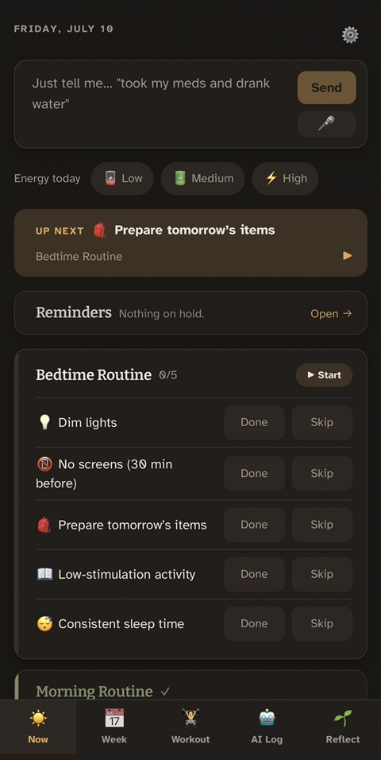
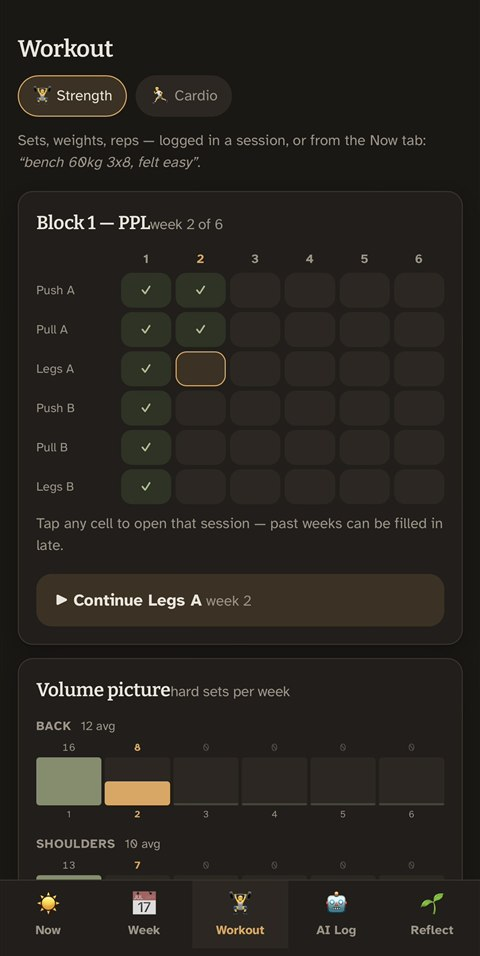
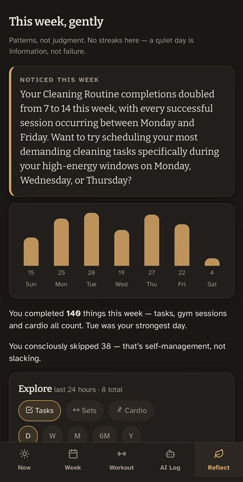
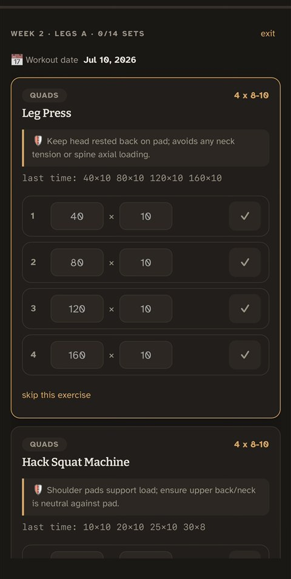
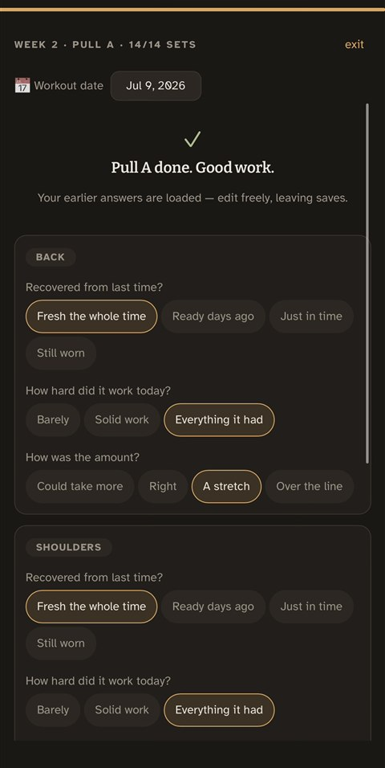
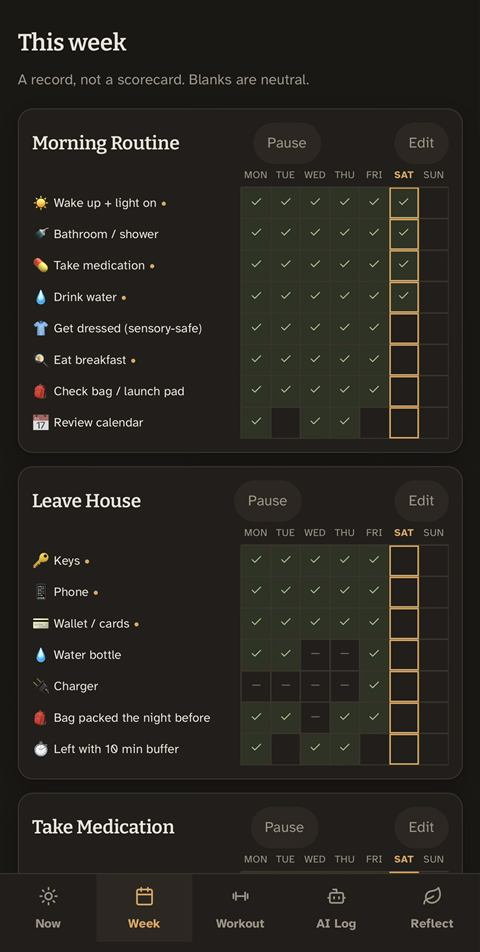
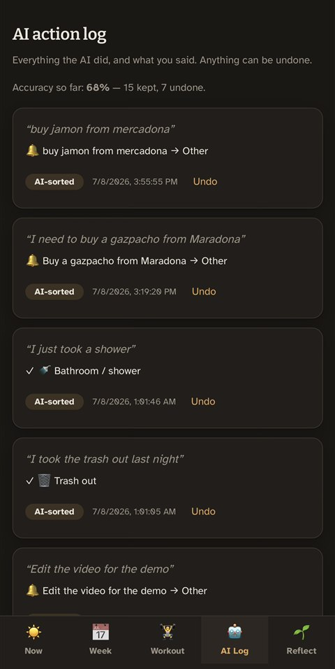

<h1 align="center">Routine Tracker</h1>

<p align="center"><em>A routine tracker that works with your brain, whatever it's like.</em></p>

<p align="center">
You just type (or say) <em>"ran 5k and did my morning routine"</em><br>
and it ticks the right boxes for you.<br>
Built gentle enough for ADHD brains, which makes it lighter for every brain.<br>
Self-hosted, free to run, no subscription.
</p>

<p align="center"><sub>React · Supabase · Gemini · installable PWA · 11 languages · AGPL-3.0</sub></p>

<p align="center">
  <a href="https://stayuptildawn.github.io/routine-tracker/?demo"><strong>▶ Try the live demo</strong></a><br>
  <sub>No account, no install. It runs entirely in your browser with a week of sample data.</sub>
</p>

<p align="center">
  
  
  
</p>

## Try it first

The quickest way to get it is to open the
[demo](https://stayuptildawn.github.io/routine-tracker/?demo) and type
something into the box on the Now tab, the way you'd say it to a friend:

> *"took my meds, drank water and benched 80 for 5"*

Even the demo has a stand-in for the AI, so simple phrasings (task names,
*"bench 60kg 3x8"*, *"ran 5k in 25 min"*, *"remind me to..."*) really apply,
with undo and the AI log working. Nothing leaves your browser.

## Why I built this

I was managing my routines in Google Docs, and honestly it was painful. It was
unresponsive on my phone, and every small update meant scrolling around a big
table hunting for the right cell. That is way too much work for just being
spontaneous, and it asks for exactly the kind of focused effort that routines
are supposed to take out of your day.

The apps made for this are mostly behind a paywall. The good ADHD planners
charge around [$3 to $12 per month](https://habi.app/insights/best-adhd-planner-apps/),
and the free tiers [keep shrinking](https://mutra.app/resources/best/best-free-adhd-planner-apps/)
as features quietly move behind the subscription. Paying a monthly fee to
manage a condition that already costs you money (people call it the
["ADHD tax"](https://affine.pro/blog/best-adhd-planner-apps)) didn't sit right
with me.

By the way, the research agrees with both complaints. If a tracker takes too
long to set up or use, ADHD brains
[abandon it before it delivers any value](https://kabitapp.com/blog/habit-tracker-adhd),
and the feature-heavy ones turn into
["productive procrastination"](https://www.mindfulsuite.com/reviews/best-habit-tracker-apps),
where you spend 20 minutes looking at completion charts instead of doing the
habits. The best tracker is
[the one that takes less time to use than the habit itself](https://routinebase.com/best-habit-tracker-apps/).

So the whole idea here is one text box. You write what you did in plain words
and the AI files it. No hunting through lists, no forms, no fee.

The other reason was simple. My life was spread across too many apps:
routines in one, workout notes in another, reminders somewhere else, and I was
the one keeping them all in sync. I just wanted one place that holds
everything, so checking my day is one move and not a hunt through five apps.

And honestly, I don't think you need an AuDHD brain to get something out of
this. I built it around mine, but everyone has days where a list feels like
too much, or where typing *"went for a run"* is easier than tapping through
menus.

> ...if you feel, like me, that building an app like this from scratch and
> washing the dishes land at the same spot on the scale, because the size of
> the task was never the hard part, just getting yourself to *execute* it is,
> then this was built for us. :)

## What it does for you

- **Files your day from one sentence.** *"did morning routine except
  shower"* checks off the whole routine and marks the shower as skipped. One
  message can hold several things at once.
- **Shrinks the day when you're low.** *"low energy today"* switches to the
  core minimum, and finishing that still counts as a full win.
- **Answers questions about your own record.** *"how consistent have I been
  with meds?"*, *"what's my best bench?"*, and it says so when the answer
  isn't in your data instead of guessing a number.
- **Remembers things for you.** *"remind me to call the bank tomorrow at
  5pm"* becomes a reminder with a due time and a push at that hour.
- **Runs your training.** Six-week blocks, a session player with last time's
  numbers pre-filled, recovery check-ins, and plan changes it suggests from
  your own volume and feedback, applied only when you tap Apply.
- **Works around injuries.** Tell it your knee hurts, see exactly what would
  change in your upcoming sessions, and undo all of it with one tap on Healed.
- **Reflects, gently.** Two sentences a day about a pattern it noticed, and
  one small experiment to try. No scores.

## What it will not do

- **No streaks, no shame.** Skips show up neutral, blanks stay blank, and
  there is no red X anywhere in the app! Words like "failed" and "missed" are
  banned in everything the AI writes for you.
- **No silent changes.** Every AI action is logged with one-tap undo, the
  unsure ones come back as "Did you mean...?" chips, and nothing ever edits
  your training plan without you pressing a button first.
- **No pretending to be a doctor.** The injury feature adjusts your sessions,
  but sharp, worsening or lasting pain goes to a physio or a doctor, and the
  app says so.
- **No subscription, no ads, no tracking.** You host it yourself on free
  tiers, and your data is one tap away from a CSV export.
- **No bluffing.** The model is not always right, my own log hovers around
  70% of actions kept. Every miss is visible and one tap from undone, which
  beats a model you have to babysit.

## Features

| Feature | What it does |
|---|---|
| **One message box** | Plain language in, check-offs, sets, cardio, reminders and energy out. Past days too: *"did the dishes yesterday"* lands on yesterday's row. Voice input works. |
| **Confidence, not guesses** | Sure actions apply with undo, the maybes come back as one-tap chips, and anything it's unsure about does nothing at all. |
| **Questions about your data** | The answer pops up on the Now tab and stays in the AI log, built only from a summary of your own rows. |
| **Routines that adapt** | Tasks have tiers (core, standard, bonus). On a low day you only see the core. |
| **Time anchors** | A routine set to "around 8:00" floats to the top near its time with a little countdown ring, a time-blindness aid, not an alarm. |
| **Routine player** | One task at a time, full screen, two big buttons, for the days when a list is already too much. An **Up next** strip picks the one task that makes most sense right now. |
| **Training blocks** | 6-week PPL then Upper/Lower, rep-wave periodization, an injury-safe execution cue on every exercise. One tap generates the whole block. |
| **Session player** | Every set with last time's numbers pre-filled, and the safety cue pinned under the exercise name. |
| **Volume picture** | Hard sets per muscle per week, plus a *"Last 4 weeks"* ranking that tags your most and least trained muscle. |
| **Suggested plan changes** | One set more or fewer on a specific exercise, with the reason in real numbers. Folded into a list, applied with one tap. |
| **Injury reports** | Upcoming sets get lighter, swapped or taken out depending on how bad it is, cardio included. **Healed** puts back exactly what changed. |
| **Weekly coach's note** | An AI read of your week against a 12-week trend, with 3 to 5 small, safety-first suggestions. |
| **Reflection** | Two sentences twice a day, in your timezone, plus an Explore chart from the last 24 hours up to 12 months. |
| **Eleven languages** | Real localization, right-to-left for Arabic and Farsi, and the Jalali calendar for Farsi. |

<details>
<summary><strong>Everything else it does</strong></summary>

<br>

**The message box, in more detail.**

- It gets how people actually talk, the exceptions and the negations.
  *"skip the run today"* does the opposite of a check without you hunting for
  a button.
- Reminders understand the clock in both directions: *"...in 10 mins"* works,
  and later *"bought the sunscreen"* clears the matching open reminder again.
  That's a status change, never a delete, and undo restores exactly what was
  there.
- Cardio takes the whole story in one line: *"ran 5k in 25 min at 152 bpm,
  felt easy"* logs distance, time, heart rate and how it felt.
- On Android, the **share sheet** works too: share text into the app from
  anywhere and it lands in the message box for review.
- The AI log keeps a running accuracy score. Questions don't count toward it,
  since they change nothing.

**Routines.**

- Routines can be **paused** from the week view: hidden from the day, the AI
  and the nudges, history intact, one tap to bring them back.
- Optional **push nudges**: if a routine's anchor passes and its core tasks
  are still pending, you get one gentle notification (*"Morning routine is
  ready when you are"*), at most once per routine per day.
- Past days can be corrected from the week grid.
- Taps work offline, and that includes the annoying in-between case: one bar
  of signal outside the house, where the phone swears it's online but nothing
  actually gets through. I kept losing Done taps there, the task would just
  pop back up later! Now a tap that hangs for 10 seconds is kept, stays on
  screen, and retries on its own.

**Training.**

- **Flexible sessions.** Fewer gym days than planned is fine, weekly volume
  matters more than the exact split. The composer builds an upper, lower or
  full-body day (or a whole short week) from what your week still needs.
- After a session, an optional **recovery check-in** per muscle: how it
  recovered, how hard it worked, how the amount felt. Those answers feed the
  suggested plan changes.
- The **suggested plan changes** are fixed rules, not the AI, so the same
  data always gives the same answer. They ease off when your check-ins keep
  saying "a stretch" or "over the line", and they only add a set when you said
  "could take more" *and* you're logging at least 80% of the planned sets,
  never on an exercise an injury puts at risk. If a muscle is light because
  the sessions just didn't happen, you get a note instead, since more sets on
  paper wouldn't change a thing. **Apply** edits the plan from the current
  phase on and asks whether the running block should follow, **Not now** sets
  it aside, and either way that muscle starts fresh.
- The coach's note knows which suggestions you applied, so it won't tell you
  to undo the set you dropped last week. It also refreshes right away when you
  report or heal an injury.
- Off-plan lifts count: *"hammer curls 14kg 3x12"* gets tagged with its
  muscle group and shows up in the volume picture instead of disappearing.
- A **cardio view** with quick logging, weekly distance and pace. If your
  watch already tracks all of that, like mine does, switch **Cardio logging**
  off in Settings. The cardio view, its chart and CSV disappear, the composer
  stops logging runs, and the coach stops commenting on cardio it can't see.
  Nothing is deleted.
- The plan is fully yours to edit, sets × reps per phase as plain fields.
  Exercise names autocomplete from a 1,289-exercise database and fill in the
  muscle group for you. Nothing saves until you press Save.

**Reflection and your data.**

- Weekly bars count everything you did (tasks, gym sessions, cardio) as
  patterns instead of pass/fail.
- The reflection knows when you've just started logging, so your first week
  is a baseline instead of a comparison against empty history.
- Half an hour before the nightly reflection, one push reminds you to log
  anything still floating around.
- One-tap CSV export of tasks, workouts, training sets, cardio, recovery
  check-ins and reminders.

**The basics.**

- Installable PWA with realtime sync across devices.
- Instant tab switches (screens stay mounted and refresh quietly).
- In the installed app the back button closes whatever is open, then returns
  to the day, and never throws you out.
- No browser popups anywhere, destructive taps confirm in-app.
- Settings for theme (auto, light, dark), language, timezone and the cardio
  switch.

</details>

<p align="center">
  
  
  
  
</p>

## How it works

```
  "took my meds and benched 80 for 5"
                 │
                 ▼
   interpret-message (Edge Function)
   + today's tasks, open reminders, your clock
                 │
                 ▼
     Gemini: a list of actions, each with a confidence
                 │
      ┌──────────┼──────────────────┐
      ▼          ▼                  ▼
   ≥ 0.9       0.6 to 0.9         < 0.6
   applied,    "Did you mean...?"  nothing
   with undo   chips to confirm    happens
      │
      ▼
   ai_actions log (every batch reversible)
```

The interpret core (`supabase/functions/_shared/interpret.ts`) gets your text
plus today's date, weekday and local clock, loads today's scheduled tasks and
your open reminders, and asks Gemini for a structured list of actions. The
day's tasks go straight into the prompt as candidates, which at personal scale
works better than embeddings and costs basically nothing. If a planned
training session is open today, logged sets fill that session's planned sets,
so the message box and the session player write the same rows.

Questions go one step further. The simple ones (*"when did I last..."*,
*"what's pending?"*) are answered straight from the database. For anything
else, a second call (`_shared/askData.ts`) answers from a compact summary of
your last 90 days, and the model is told to use only that summary.

One lesson from running this on small models is baked in: anything
time-shaped is never left to the model's arithmetic. *"in 10 mins"*, *"at
5pm"*, *"tomorrow"*, *"yesterday"* are all resolved in code against your clock
and timezone, the model only has to point at the right task or reminder. And
every AI call in the project goes through one shared helper
(`_shared/gemini.ts`) that owns the model chain, so an overloaded model, a
used-up quota or a retired model name just means "try the next one" instead of
taking the feature down.

## Quick start

**Just want to see it?** Open the
[demo](https://stayuptildawn.github.io/routine-tracker/?demo), that's it.

**Want your own?** You need a free [Supabase](https://supabase.com) project, a
free [Gemini API key](https://aistudio.google.com/apikey) and a GitHub
account for hosting. Then:

```sh
git clone https://github.com/Stayuptildawn/routine-tracker.git
cd routine-tracker
cp .env.example .env    # fill in from Supabase Settings > API
npm install
npm run dev
```

<details>
<summary><strong>Full setup, step by step</strong></summary>

### 1. Supabase project

1. Create a project at [supabase.com](https://supabase.com).
2. Run the migrations in `supabase/migrations/` **in order** (0001 upward)
   with `supabase db push`, or paste them one file at a time into the SQL
   editor (it runs each paste as one transaction).
3. In **Authentication > Providers**, enable Email. Disable "Confirm email"
   if you want instant signup.

### 2. Edge Functions

```sh
npm i -g supabase
supabase login
supabase secrets set GEMINI_API_KEY=<your-gemini-api-key>
supabase functions deploy interpret-message --project-ref <ref>
supabase functions deploy refresh-coach --project-ref <ref>
```

Mind that you should keep the Gemini project unbilled to stay on the free
tier. The functions share code from `supabase/functions/_shared/`, which the
CLI uploads for you (the dashboard paste-editor can't).

**Optional extras**, each one independent:

- **AI reflections and the weekly coach**: set a `CRON_SECRET` secret, deploy
  `weekly-reflection` with `--no-verify-jwt`, enable `pg_cron` and `pg_net`,
  and schedule a `net.http_post` to it every 15 minutes with an
  `x-cron-secret` header. The function decides by itself when to actually
  write, in each user's timezone. One gotcha that cost me an afternoon: pass
  `timeout_milliseconds := 20000`, since pg_net's default of 5 seconds kills
  the function exactly when it has real work to do.
- **Push nudges**: generate keys with `npx web-push generate-vapid-keys`, set
  `VAPID_PUBLIC_KEY`, `VAPID_PRIVATE_KEY`, `VAPID_SUBJECT` (a mailto:) and
  `CRON_SECRET`, add the public key as a `VITE_VAPID_PUBLIC_KEY` repo secret,
  deploy `send-nudges` with `--no-verify-jwt`, and schedule it every 5
  minutes (same 20-second timeout). iOS needs the app installed to the home
  screen.
- **AI canary**: deploy `ai-canary` with `--no-verify-jwt`, set
  `CANARY_SECRET` and `OWNER_EMAIL`, and schedule it once a day. If the whole
  Gemini model chain ever fails, you get one push that morning instead of
  finding out mid-message.
- **CI function deploys**: add a `SUPABASE_ACCESS_TOKEN` repo secret and a
  `SUPABASE_PROJECT_REF` repo variable, and every push that touches
  `supabase/functions/` deploys them after the tests pass. Without the secret
  the workflow just skips itself.

### 3. Deploy on GitHub Pages

1. Push the repo to GitHub.
2. **Settings > Pages**: set Source to "GitHub Actions".
3. **Settings > Secrets and variables > Actions**: add `VITE_SUPABASE_URL`
   and `VITE_SUPABASE_API_KEY` as repository secrets (just the values,
   nothing else!).
4. Push to `main` and `.github/workflows/deploy.yml` builds and publishes it.
5. Supabase **Authentication > URL Configuration**: add your Pages URL
   (`https://<user>.github.io/<repo>/`) as a redirect URL.

Once your own account exists, I recommend turning off "Allow new users to
sign up" in the Supabase Auth settings, so strangers can't use your AI quota.

</details>

## Project structure

```
routine-tracker/
├── src/
│   ├── screens/          # Now, Week, Gym (Workout), Reflect, Session, Settings...
│   ├── lib/              # the logic: blocks, flex sessions, injuries, volume
│   │                     #   tuning, offline queue, demo fake backend
│   ├── i18n/             # one typed file per language (en.ts is the source)
│   ├── components/       # icons, skeletons, the in-app confirm button
│   └── index.css         # the whole design system, one file
├── supabase/
│   ├── migrations/       # 0001 upward, run in order
│   └── functions/
│       ├── _shared/      # interpret, askData, trainingReview, gemini helper
│       ├── interpret-message/
│       ├── refresh-coach/
│       ├── weekly-reflection/
│       ├── send-nudges/
│       └── ai-canary/
├── tests/                # vitest: parsing, planners, the offline queue
├── scripts/              # exercise-db builder, live smoke test
└── docs/screenshots/
```

## Design

The UI follows its own bedtime advice (dim lights, no screens): a warm,
low-blue "lamplight" palette, one amber accent, sage green for done. The body
font is Atkinson Hyperlegible, which was designed by the Braille Institute for
maximum legibility.

Every icon is a hand-rolled inline SVG (no icon font, no emoji in the
chrome), so they look the same on every device and follow the theme colors
instead of whatever your OS ships.

## Stack

React, Vite and TypeScript on the front. Supabase (Postgres, Auth, Realtime,
Edge Functions, pg_cron) behind it, Gemini Flash-Lite for the AI, Web Push for
nudges, and GitHub Pages for hosting.

No chart libraries, no drag-and-drop libraries, no CSS framework. The bars are
plain divs and the whole design system is one CSS file.

Exercise-name autocomplete uses a trimmed extract (names and muscle groups
only, about 9 KB gzipped, loaded on demand) of the MIT-licensed
[exercises-dataset](https://github.com/hasaneyldrm/exercises-dataset) by Hasan
Eyildirim. Regenerate it with `scripts/build-exercise-db.mjs`.

## FAQ

**Does it cost anything?**

Not on the free tiers, which is how I run it. If you turn on Gemini billing,
the AI costs about $0.0002 per message, so around 100 messages a day stays
well under $1 a month.

**How many users can this handle?**

It's built for one person, me. Each user has their own timezone and
language, the starter routines and plan are opt-in, and every background job
walks all accounts, so a handful of accounts on one instance works fine. Here
is where the free tiers would actually break, in order:

1. **Gemini (unbilled) is the real limit.** Roughly 15 requests a minute and
   about 1,000 to 1,500 a day. Every message is one request, a free-form
   question is two. At 20 to 30 messages per user per day, that's about 30 to
   50 active users, and one user never gets close.
2. **Supabase Realtime allows 200 concurrent connections**, so about 100 to
   150 apps open at the same time.
3. **Everything else is far away.** The cron jobs use about 12K of the 500K
   monthly function calls, a whole 6-week training block is about 700 tiny
   rows in a 500 MB database, and GitHub Pages barely notices a 450 KB app.

**Is my data safe?**

Every table is locked to its owner by the database itself (Postgres Row
Level Security), so even if I made a mistake in the code and asked for
everyone's data, the database would still only return yours. The key inside the app is public on
purpose, that's how Supabase works, and it opens nothing without you being
logged in. The secrets that matter (the AI key, the admin key, the push keys)
stay on the server.

When you ask a question, the server builds a short summary of your own rows
and that summary is the only thing the AI sees. There's a test that puts
another user's data in the database and checks that none of it reaches the
AI. That summary, like every message you type, is sent to Gemini, which is
Google's.

This is a personal project I host myself, and no security company has
audited it. Some background jobs run with higher access and rely on my code to
stay scoped to the right person, and GitHub Pages doesn't let me set a couple
of extra security headers I'd add on my own server.

**Can it read my workouts from Apple Health or my watch?**

No. An installed web app can't read Apple Health or Health Connect, so
there's a **Cardio logging** switch in Settings instead. If your watch already
tracks your runs, turn it off and the app stops asking.

**Is the injury feature medical advice?**

No. It adjusts your upcoming sessions so you can keep training around
something that hurts, and it says plainly that sharp, worsening or lasting
pain goes to a physio or a doctor.

**Can I add my language?**

Yes. Copy `src/i18n/en.ts`, translate the values and
register it in `src/i18n/index.ts`. Every pack is typed against the English
one, so TypeScript tells you about anything you missed.

## About me

I'm Mohammad. I built this around my own AuDHD brain, because I needed it and
couldn't find one that didn't charge me monthly for it. I'm nowhere near done
with it, I keep adding to it, and I'd like it to fit more people than just
me. So if you have an idea, I'm happy to hear it, and if the project is
useful to you and you want to help keep it going, suggestions and donations
are both welcome.

## License

Copyright (C) 2026 Mohammad Soleimani Roudi

This program is free software: you can redistribute it and modify it under
the terms of the [GNU Affero General Public License](LICENSE) (AGPL), version
3 or later. It comes with no warranty.

I picked the AGPL on purpose. It's the one license that also covers hosting,
so if someone runs a changed version of this as a web service, they have to
share their source too. Given the whole reason I built this (no paywalls, keep
it free for the next person), that felt like the honest choice.
